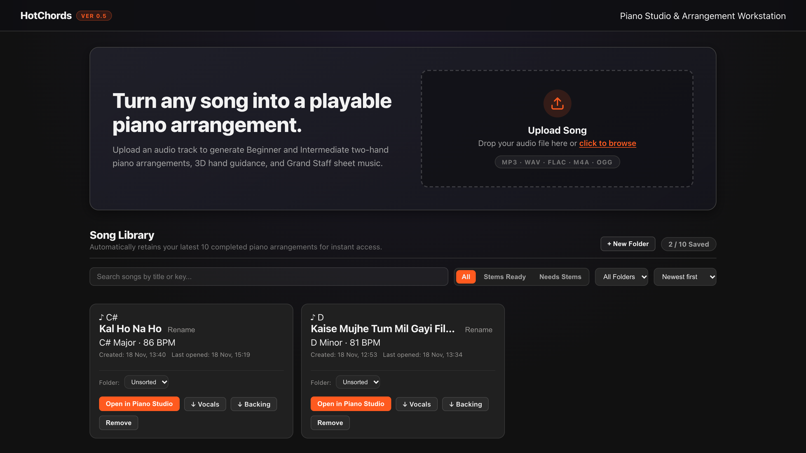
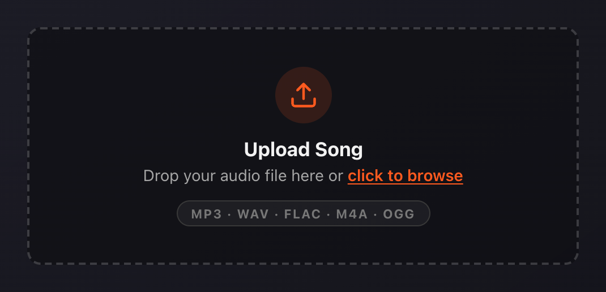
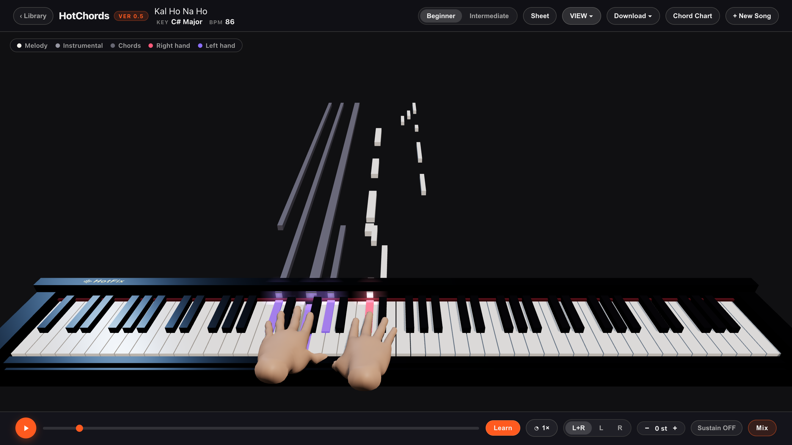
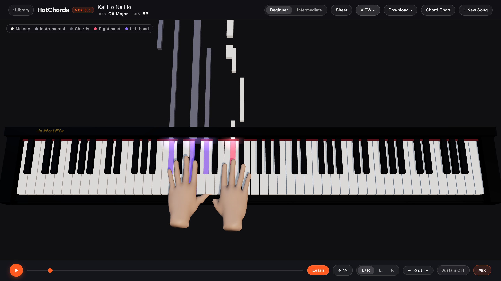
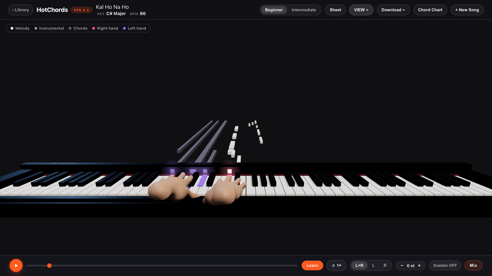
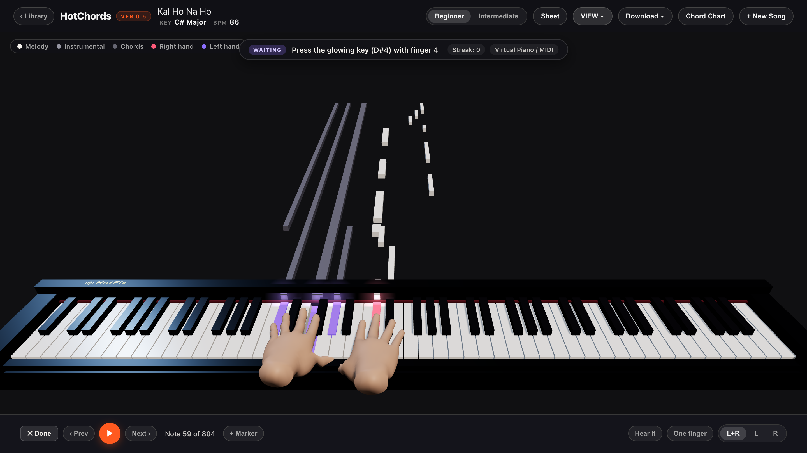
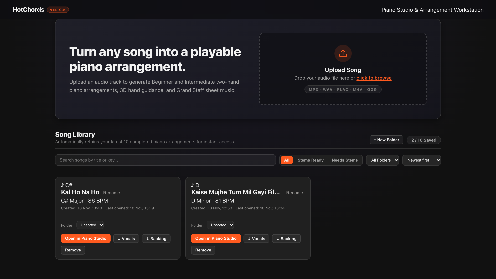

# HotChords

**Turn any song into a playable piano arrangement — 100% locally on your computer.**

HotChords (`v0.5.0`) is a **free and open-source** local-first desktop music workstation that analyzes audio files on your own machine and generates two-hand piano arrangements with a 3D Piano Studio, falling note highway, Grand Staff sheet music, diatonic chord charts, and interactive practice tools.

No subscriptions, no accounts, no ads, and no cloud uploads.

---

## Screenshots (`v0.5.0`)

### 1. Home Screen

*Dark charcoal workstation shell with upload entry point and local Song Library.*

### 2. Audio Upload

*Drag-and-drop or browse audio upload supporting MP3, WAV, FLAC, M4A, and OGG.*

### 3. Piano Studio — Performer View

*88-key 3D piano with falling note highway, left/right hand guides, and physical gold HotFix fascia branding.*

### 4. Piano Studio — Overhead View

*Top-down view showing active note lanes, key illumination, and hand placement.*

### 5. Piano Studio — Close-up View

*Low-angle close-up of key presses and hand positioning.*

### 6. Playback & Learn Mode

*Interactive Learn Mode HUD, synchronized transport bar, speed/transposition controls, and mixer.*

### 7. Song Library

*Local Song Library retaining up to 10 arrangements with search, filters, folders, and stem downloads.*

---

## Key Features & Implementation Status

### Implemented and Verified
- **Local Audio Analysis & Song Library:** Upload `MP3`, `WAV`, `FLAC`, `M4A`, or `OGG` files. Stores up to 10 arrangements locally with search, folders, renaming, and on-demand vocal/backing stem downloads.
- **Source Separation:** Uses Demucs (`htdemucs`) and Harmonic-Percussive Source Separation (HPSS) to isolate harmonic content from drums and vocals. (An optional `roformer` adapter exists for `audio-separator`, which is not bundled by default.)
- **Note & Chord Transcription:** Combines Basic Pitch ONNX (`nmp.onnx`) polyphonic note transcription, HotChords native DSP transcription, and `lv-chordia` / CQT Chroma harmonic analysis.
- **Two-Hand Piano Arrangements:** Generates **Beginner** and **Intermediate** left-hand / right-hand arrangements and exports Standard MIDI (`.mid`) files.
- **3D Piano Studio, 2D Roll & Sheet Music:** Switch between **3D Piano** (`Performer`, `Overhead`, `Close-up`), **2D Roll**, and **Grand Staff Sheet Music** (`Sheet`).
- **Synchronized Playback & Learn Mode:** Unified `PlaybackClock` driving Salamander Grand Piano samples, original/stem mixing (`Mix`), hand isolation (`L+R`, `L`, `R`), speed (`0.5×–1.5×`), transposition (`±12 st`), and microphone pitch feedback in **Learn** mode.

### Partially Implemented
- **3D Hand Articulation:** Left and right 3D hand models track active keyboard regions, while finger-by-finger anatomical articulation and natural transition posture remain limited.

---

## System Requirements

- **macOS (Prebuilt DMG):** macOS 11.0 (Big Sur) or later on **Apple Silicon** (`arm64`). *(Prebuilt Intel macOS binaries are not provided for `v0.5.0`.)*
- **Windows (Pending CI Verification):** Windows 10 / 11 (64-bit `x64`).
- **Hardware:** 8 GB RAM minimum (16 GB recommended for Demucs stem separation).
- **Browser:** Modern Chrome, Edge, Safari, or Firefox with WebGL and Web Audio support.

---

## Installation (`v0.5.0`)

Current Version: `0.5.0`

### macOS (Apple Silicon)
1. Download `HotChords-v0.5.0-macOS-AppleSilicon.dmg` from [GitHub Releases](https://github.com/itshotfix/HotChords/releases).
2. Open the `.dmg` and drag **HotChords.app** into **Applications**.
3. Launch **HotChords**.

> **Gatekeeper Notice:** The macOS `.dmg` is ad-hoc signed (`codesign -s -`) and **not Apple notarized**. macOS will display a security warning on first launch; right-click **HotChords.app → Open** (or allow via *System Settings → Privacy & Security*).

### Windows (x64) — Pending Verification
- **Current Status:** Windows `v0.5.0` support is **pending** until `HotChords-v0.5.0-Windows-x64-Setup.exe` is built and validated on GitHub's Windows runner.
- Once published on [GitHub Releases](https://github.com/itshotfix/HotChords/releases), download the `.exe`, double-click it, and follow the setup steps.

### Optional One-Command Installation Scripts
For users who prefer installing from a terminal after `v0.5.0` release assets are published (both scripts verify the official GitHub Release SHA-256 checksum before installing):

- **macOS (Apple Silicon):**
  ```bash
  bash scripts/install-macos.sh
  ```
- **Windows (PowerShell, x64):**
  ```powershell
  powershell -ExecutionPolicy Bypass -File scripts\install-windows.ps1
  ```

---

## Basic Usage

1. Launch HotChords (opens `http://hotchords.localhost:<PORT>` in your browser).
2. Drop an `MP3`, `WAV`, `FLAC`, `M4A`, or `OGG` audio file onto the upload card.
3. Wait for local separation, transcription, and arrangement to complete.
4. Explore your arrangement in **3D Piano** (`Performer`, `Overhead`, `Close-up`), **2D Roll**, or **Sheet** view.
5. Use **Learn** to practice step-by-step, **Mix** to balance piano vs. stems, or **Download** to export `.mid` and stems.

---

## Privacy & Local Processing

HotChords processes all audio, stems, transcriptions, microphone input, and saved songs **100% locally** on your machine. No audio files or usage telemetry are sent to external servers.

---

## Known Limitations & Future Roadmap

### Known Limitations
- **AI Transcription:** Accuracy varies with recording quality, instrumentation, and polyphonic density. Not every optional engine is active by default (`Basic Pitch ONNX` + `hotchords_native` are bundled; optional `roformer` requires installing `audio-separator`).
- **Chord Recognition:** Complex voicings and rapid harmonic transitions may be simplified or misclassified.
- **Piano Arrangement:** Fingering and left/right hand allocation can require manual refinement on dense tracks.
- **3D Piano Studio:** Core 3D piano, camera presets, horizontal `HotFix` fascia branding, and highway-scoped chord labels are verified, while natural finger-by-finger hand articulation remains limited.
- **Source Separation:** Demucs (`htdemucs`) and HPSS are operational locally; `roformer` requires extra optional dependencies.
- **Platform Support:** Apple Silicon macOS DMG is locally verified (ad-hoc signed, not notarized). Windows `v0.5.0` installer verification is pending GitHub Actions Windows runner execution. Prebuilt Intel Mac binaries are not provided.
- **Human Validation:** Automated CI checks (module imports, JS syntax, asset checks, and `/health` startup) do not guarantee musical accuracy; manual listening tests and human-annotated MIDI comparisons are still needed.

### Future Roadmap
1. Improve note transcription accuracy on complex polyphonic recordings.
2. Improve chord recognition on dense or rapid progressions.
3. Improve fingering and two-hand piano arrangement quality.
4. Improve 3D hand articulation and natural finger movement.
5. Improve source separation robustness.
6. Improve Windows and macOS distribution, code signing, and Apple notarization.
7. Build human-validated transcription quality benchmarks.

---

## Build From Source (Developers)

Requires **Python 3.10+** (tested on 3.11), **Node.js 18+**, and **FFmpeg**.

```bash
git clone https://github.com/itshotfix/HotChords.git
cd HotChords

python3 -m venv venv
source venv/bin/activate   # Windows: venv\Scripts\activate
pip install -r requirements.txt

python hotchords.py
```

- [System Architecture](docs/architecture/system-architecture.md)
- [Troubleshooting](docs/getting-started/troubleshooting.md)
- [Contributing Guide](CONTRIBUTING.md)
- [Changelog](CHANGELOG.md)
- [Security Policy](SECURITY.md)

---

## Licence & Attributions

HotChords is open-source software licensed under the [LICENSE](LICENSE).

Third-party library and model attributions are documented in [THIRD_PARTY_LICENSES.md](docs/assets/documentation/THIRD_PARTY_LICENSES.md).
